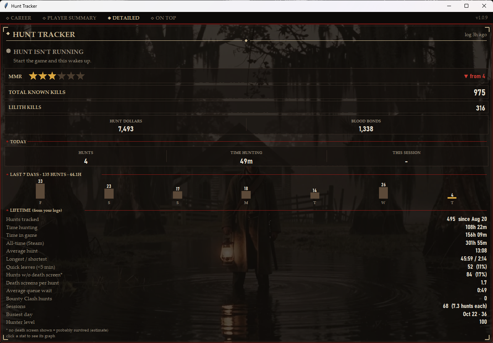
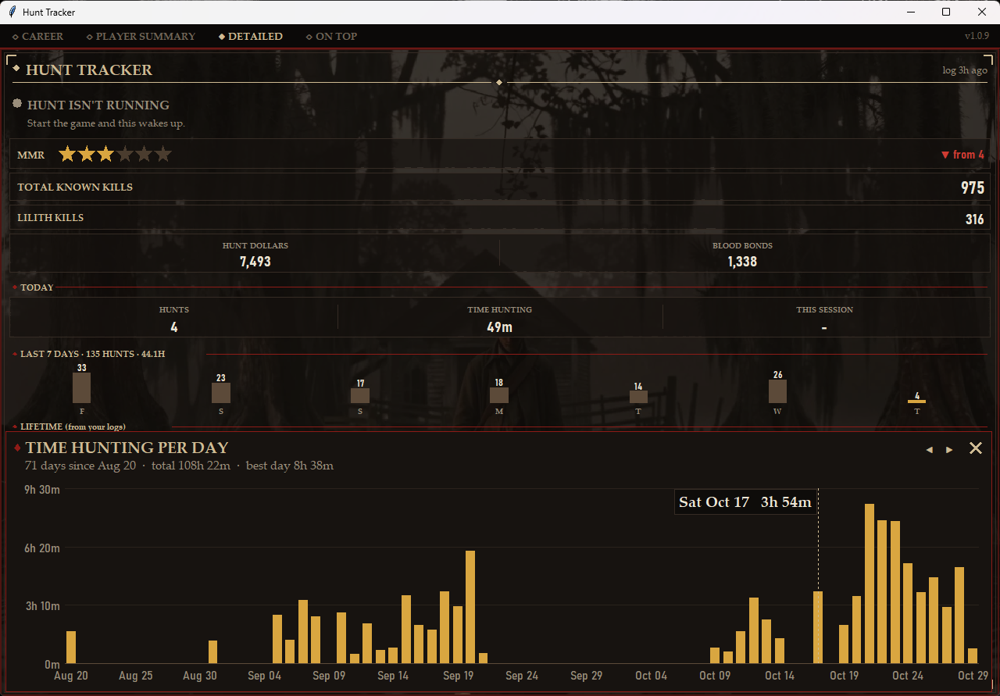
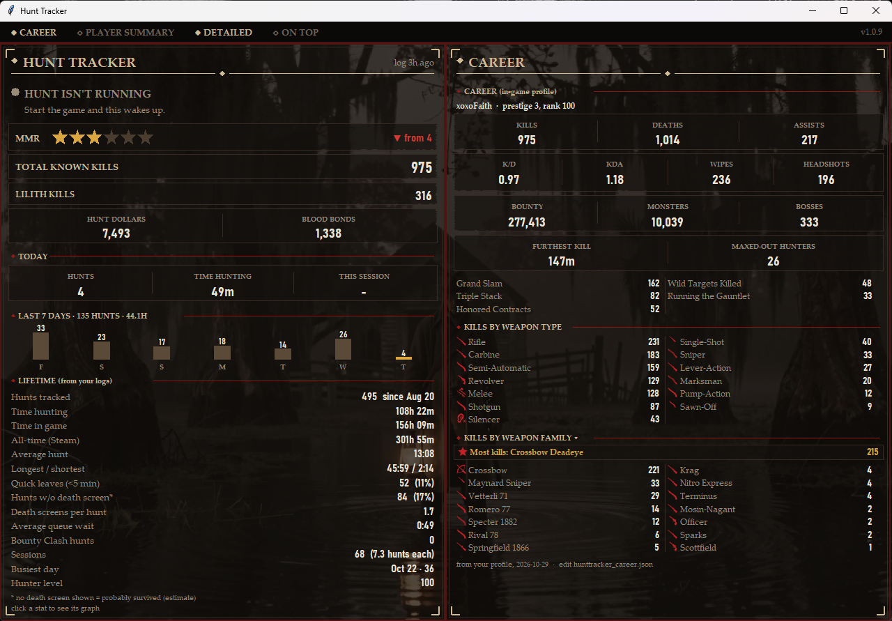

# Hunt Tracker

A live stats window for **Hunt: Showdown 1896**. Put it on your second monitor and it fills itself in
while you play: what you're doing right now, your hunts and hours, your career stats, weapon kills,
MMR, and the players you keep running into. You don't press or type anything.



> Unofficial fan project. Not made, endorsed or supported by Crytek, Steam or Valve.
> It never touches the game: no memory reading, no injection, no changes to game files.

## Download

Get **HuntTrackerSetup.exe** from the [latest release](../../releases/latest) and run it. It installs
for your Windows user only (no admin needed) and can open itself automatically whenever Hunt starts.

The installed app **updates itself**: each time it opens it checks this repo's releases and, if
there's a newer version, shows a small "Checking for updates" window with a progress bar, installs
it and reopens. Your data is kept.

Windows may warn that the app is from an unknown publisher the first time (it isn't code-signed):
click **More info → Run anyway**.

## What it tracks

**Right now**
- Whether you're in the menus, searching, loading in, in a hunt or on the post-match screen
- In a hunt: the time left on the mission (an estimate until you hold Tab, then synced to the map's timer)
- Your MMR stars (from Team Details after a match), and whether they went up or down
- Total known kills, your most-played hunter's kills, Hunt Dollars and Blood Bonds

**Today / last 7 days**
- Hunts, time hunting and the current session length, plus a bar chart of the last 7 days

**Lifetime (from your logs)** — click any of these to pop out a day-by-day graph
- Hunts tracked, time hunting, time in game, all-time hours from Steam
- Average, longest and shortest hunt, quick leaves (under 5 minutes)
- Hunts without a death screen, death screens per hunt, average queue wait
- Bounty Clash hunts, sessions, busiest day, hunter level



**Career** (read from your in-game Statistics page)
- Kills, deaths, assists, K/D, KDA, wipes, headshots, bounty, monsters, bosses, furthest kill
- Kills by weapon type (rifle, shotgun, sniper, silencer…) and by weapon family (Crossbow, Krag,
  Vetterli 71…), plus your variant with the most kills
- A family picker: click **KILLS BY WEAPON FAMILY ▾** to choose which families are shown



**Player Summary**
- Your squad and the other players from the loading cards, with their stats
- Who killed you this match and how often they've killed you overall
- Anyone you've met before ("encountered 3 times") and their MMR from last time

## How it works

Hunt doesn't save match results or stats on your PC (it gets them from its servers), so the
tracker gathers them from two places:

1. **Hunt's own log file** (`USER\Game.log`). The game writes a line whenever you open a menu,
   start searching, load into a match or return to the lobby. The tracker reads those lines to
   know what you're doing and how long each hunt and queue took. It also reads older logs once,
   so your history starts before you installed it.
2. **The screen, only while Hunt is the active window.** On specific screens (loading cards,
   death screens, the post-match summary, Team Details, the Statistics pages and the map timer)
   it takes a screenshot and reads the text with **Windows' built-in text recognition**
   (`Windows.Media.Ocr`, run through PowerShell). Nothing is uploaded anywhere.

Steam's all-time playtime comes from Steam's own `localconfig.vdf`. That's everything: no game
memory, no network traffic to or from the game, no input sent to the game.

## Your data

Everything stays on your PC:

| What | Where (installed app) |
| --- | --- |
| Settings | `%LOCALAPPDATA%\HuntTracker\hunttracker.json` |
| Hunts, sessions, players, MMR | `%LOCALAPPDATA%\HuntTracker\hunttracker_history.json` |
| Career stats | `%LOCALAPPDATA%\HuntTracker\hunttracker_career.json` |
| Saved post-match screenshots | `%LOCALAPPDATA%\HuntTracker\summaries\` |

The only thing it fetches from the internet is the update check against this repo's releases
(turn it off with `"auto_update": false` in the settings).

## Running from source

Plain Python 3.9+ on Windows, no packages to install.

```bash
py hunttracker.py            # the tracker window
py hunttracker.py --web      # the same view in a browser tab (http://127.0.0.1:8765)
py hunttracker.py --console  # text only
py hunttracker.py --log "D:\Steam\steamapps\common\Hunt Showdown 1896\USER\Game.log"
```

Run from source, it keeps its settings and data next to the script. It finds `Game.log`
by itself through your Steam libraries, or asks you for it once.

The weapon icons and the background picture come from Hunt itself, so they aren't in this
repository (they belong to Crytek). Without them the tracker works the same, just without the
icons and the backdrop; the installer has them.

## Building the installer

Needs [PyInstaller](https://pyinstaller.org) (`py -m pip install pyinstaller`) and
[Inno Setup 6](https://jrsoftware.org/isinfo.php).

- `Build Installer.bat` draws the app icon, builds `Hunt Tracker.exe` with PyInstaller and wraps
  it in `installer\Output\HuntTrackerSetup.exe` with Inno Setup.
- `Publish Update.bat` raises the version number, builds, and creates a GitHub release with the
  installer attached (needs the [GitHub CLI](https://cli.github.com)). Every installed copy picks
  it up the next time it opens.

## Project layout

| File | What it is |
| --- | --- |
| `hunttracker.py` | The whole app: log reading, screen reading, stats, drawing, updates |
| `installer/HuntTracker.iss` | Inno Setup script (per-user install, optional "open with Hunt", silent updates) |
| `installer/version.py` | Prints or raises the version in `hunttracker.py` |
| `installer/make_icon.py` | Draws the app icon |
| `installer/make_weapon_icons.py` | Cuts the weapon icons out of in-game screenshots |
| `installer/LICENSE.txt` | Terms shown by the installer |
| `Build Installer.bat`, `Publish Update.bat` | Build and release scripts |

## License

[MIT](LICENSE). Hunt: Showdown and its artwork belong to Crytek.
