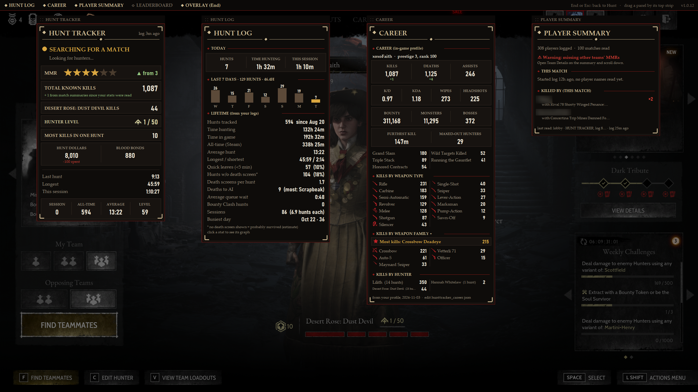
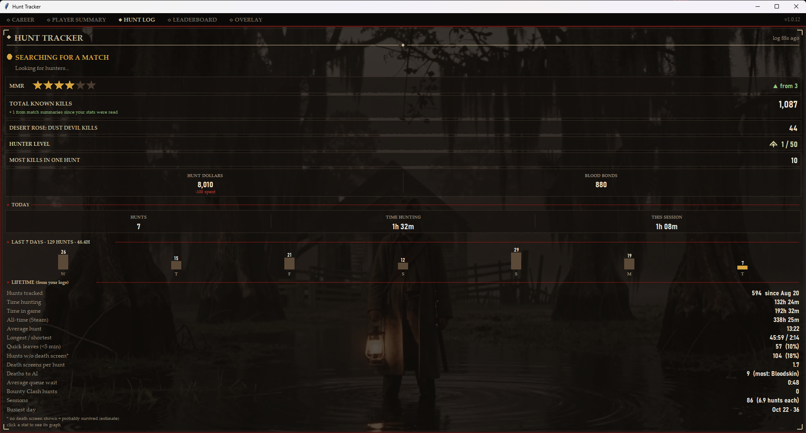
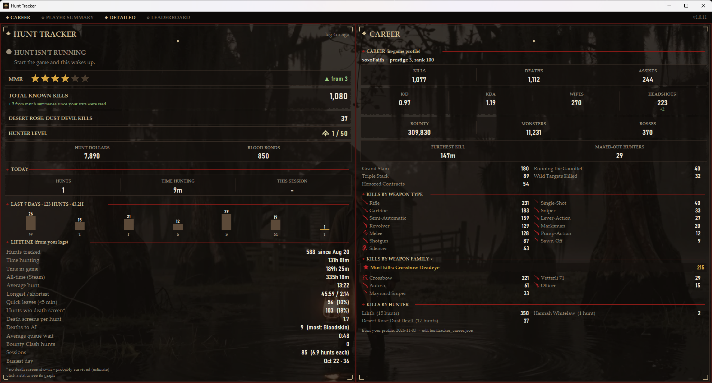

# Hunt Tracker

Live stats for **Hunt: Showdown 1896**, as an overlay over the game (press **End**) or a window on
your second monitor. It fills itself in while you play: what you're doing right now, your hunts and
hours, your career stats, weapon and hunter kills, MMR, the players you keep running into, and a
leaderboard with your friends. You don't type anything.



> Unofficial fan project. Not made, endorsed or supported by Crytek, Steam or Valve.
> It never touches the game: no memory reading, no injection, no changes to game files.

## Download

Get **HuntTrackerSetup.exe** from the [latest release](../../releases/latest) and run it. It installs
for your Windows user only (no admin needed) and can open itself automatically whenever Hunt starts.

The installed app **updates itself**: each time it opens it checks this repo's releases and, if
there's a newer version, shows a small "Checking for updates" window with a progress bar, installs
it and reopens. Your data is kept.

Windows may warn that the app is from an unknown publisher the first time (it isn't code-signed):
click **More info → Run anyway**.

## What's new in 1.0.13

- **Overlay**: press **End** in Hunt and the tracker comes up over the game: the game dims and the
  panels (Hunt Tracker, Hunt Log, Career, Player Summary) sit on top, with a bar of toggles across the
  top. Drag a panel anywhere and it stays there; click names, stats and headings like in the window. **End**, **Esc** or a click on the dimmed game
  takes you straight back. While it's open your clicks stay in the overlay and never reach the game.
- **Overlay or window, your choice**: the **OVERLAY** button, or right-clicking the tracker's icon by
  the clock, switches between the overlay and a normal window for a second monitor. It remembers your
  pick; overlay is the default.
- **Tray icon** by the clock (Overlay / Windowed / Overlay key / Open / Send diagnostics / Show artwork /
  Quit), and a short "Hunt Tracker is running" note at the bottom of the screen when Hunt starts.
  **Overlay key…** lets you pick another key (press it, then Enter); **Show artwork** switches the
  picture behind the tracker's window on or off.
- **Report an issue**: the button next to OVERLAY opens a box to describe a problem; it's sent to the
  developer with the tracker's version and setup.
- In the overlay, click a player for their card, a Hunt Log stat or Hunt Dollars for its graph (it opens
  right over it), and the weapon family / type headings to pick which show, like in the window.
- **Most kills in one hunt** has its own row.
- **Prestige and rank** are read from your card on the lobby's squad page (the badges under your name),
  the lobby's player banner, the Equipment page and the post-match Bloodline Progress, with a bar on
  the Career page showing how far you are to rank 100.
- **Teammates' and killers' rank**: your squad's prestige and rank show on their boxes under YOUR SQUAD,
  and whoever killed you shows theirs under KILLED BY, with the game's medal and skull icons.
- **Diagnostics**: a report about once an hour helps find bugs (see [Your data](#your-data)); it asks once,
  and can be switched off from the icon by the clock.
- **Career keeps counting**: your kills, deaths, K/D and KDA go up from your matches between visits to
  the Statistics page; opening Statistics confirms or corrects them.
- **Barcode names**: players whose names show as boxes (letters Hunt's font can't draw) are kept on the
  loading cards, Team Details and death screens. One unreadable name used to lose every card.
- **Weapon types** can be picked like the weapon families: click **KILLS BY WEAPON TYPE ▾** on the Career
  page to choose which show.
- Fixes:
  - after a long post-match screen the lobby and squad page stopped being read until the next hunt;
  - with only your card on the squad page, the page title ("Statistics") was taken as your name, so
    your stats, prestige and rank were never read;
  - card titles ("Outlaw", "Survivalist") and the Steam overlay's menus are no longer kept as players;
  - a misread weapon family ("Auto-S" for Auto-5) no longer shows up as a second family, and ones
    already saved are merged into the real one;
  - the weapon family / type lists open on the monitor you clicked, not always the main one, and in
    the overlay they no longer sometimes jump to the top-left corner;
  - Player Summary's "matches read" no longer stops at 100;
  - the leaderboard and diagnostics questions open on top of Hunt instead of behind it.
  - the lobby's Equipment page was read as a squad (a player called "Health");
  - a teammate with a barcode name could make the squad page take the hunter row ("Cousin Jed 12")
    as player names;
  - a barcode player whose stats are all 0 was dropped from the loading cards;
  - prestige and rank are also read from the Equipment page, a prestige of 4 no longer misreads,
    and a new rank shows within seconds instead of up to a minute or more.
  - a loading-screen tip ("...when the usage is complete.") was read as a death screen and its last
    words kept as your killer.

## What's new in 1.0.12

- **Your hunter, live**: the hunter you pick in the lobby is read as soon as it shows (no need to
  ready up), with its full name and skin ("Desert Rose: Dust Devil"), and a **Hunter Level** row
  (with the game's level icon) sits under its kills.
- **Hunt Dollars graph**: click Hunt Dollars for its history day by day, plus what your hunts earned.
  Buying your loadout shows "−N spent" until the match loads; "+N this hunt" counts whether or not
  you extract. Money is checked every second in the menus.
- **Reads Hunt in the background**: if Hunt is showing on one monitor while you click around on
  another, the tracker still reads it (only minimized or covered windows are skipped).
- **Game Menu backup**: in a match, pressing Esc lets the tracker pick up your squad, hunter and level
  from the Game Menu if it missed the loading cards.
- **Better reading**: card titles ("Survivalist", "Bound by Blood"), hidden names, the prestige
  badges and lobby buttons no longer get read as players or hunters.
- **Leaderboard** ranks by KDA; click a player for their full card.

## What's new in 1.0.11

- **Leaderboard**: share your Career stats (opt in or out any time) and see how you rank against
  everyone else using the tracker.
- **Kills by hunter**: the tracker notes which hunter you readied up with and counts that match's
  kills for them. Your loading card's or profile's "<Hunter> Kills" number takes over whenever the
  game shows one. The kills row on the main page follows the hunter you're playing.
- **Deaths to AI**: "Killed by Meathead" (or a Hive, Butcher, a fall...) is counted, instead of being
  missed or mistaken for a player.
- **Click a player** in Player Summary to see everything tracked about them.
- **Faster screen reading**: Windows' text recognition is now called straight from memory, about
  10× faster than before, and it reads screens the old way sometimes missed.
- **Text log instead of images**: what each screen said is kept as text (`screen_log.jsonl`); new
  screenshots aren't stored. Screenshots saved by older versions are read once and then removed.
- **Cleaner player list**: menu text, card titles ("Bound by Blood") and number plates are no longer
  logged as players, and "2 Maester" is now just Maester.
- Labels shrink to fit narrow or vertical windows; the ON TOP toggle is gone (it's meant for a
  second monitor).

## Overlay or window

- **Overlay** (the default): nothing on your screen until you press **End** in Hunt. The tracker's
  window stays hidden; its icon sits by the clock.
- **Window**: a normal window you can leave open on a second monitor, like before. End is left to the
  game.

Switch with the **OVERLAY** button at the top, or right-click the icon by the clock and pick
**Overlay** or **Windowed**.



## What it tracks

**Right now**
- Whether you're in the menus, searching, loading in, in a hunt or on the post-match screen
- In a hunt: the time left on the mission (an estimate until you hold Tab, then synced to the map's timer)
- Your MMR stars (from Team Details after a match), and whether they went up or down
- Total known kills, kills and level of the hunter you're playing (full name and skin), most kills in one hunt
- Hunt Dollars and Blood Bonds: "+N this hunt" during a match, "−N spent" while you buy your loadout;
  click Hunt Dollars for its graph

**Today / last 7 days**
- Hunts, time hunting and the current session length, plus a bar chart of the last 7 days

**Lifetime (from your logs)**: click any of these to pop out a day-by-day graph
- Hunts tracked, time hunting, time in game, all-time hours from Steam
- Average, longest and shortest hunt, quick leaves (under 5 minutes)
- Hunts without a death screen, death screens per hunt, deaths to AI, average queue wait
- Bounty Clash hunts, sessions, busiest day

**Career** (read from your in-game Statistics page, squad screen and profile card)
- Kills, deaths, assists, K/D, KDA, wipes, headshots, bounty, monsters, bosses, furthest kill; kills
  and deaths keep counting from your matches (green +N) until Statistics is opened again
- Kills by weapon type (rifle, shotgun, sniper, silencer…) and by weapon family (Crossbow, Krag,
  Vetterli 71…), plus your variant with the most kills
- Kills by hunter, for every hunter you've played
- A family picker: click **KILLS BY WEAPON FAMILY ▾** to choose which families are shown



**Player Summary**
- Your squad and the other players from the loading cards, with their stats
- Who killed you this match (players and AI) and how often they've killed you overall
- Anyone you've met before ("encountered 3 times") and their MMR from last time
- Click a player for their whole record: when you met, teammate or enemy, MMR, every stat read
  from their card and squad screen, and each time they killed you (hunter and weapon)

## Leaderboard

Click **LEADERBOARD** at the top. The first time, the tracker asks whether to share your Career
stats; you can switch it with **Share my stats / Stop sharing** whenever you like, and stopping
removes your entry.

- Everyone is ranked by **KDA**; each row shows **kills, deaths, assists, K/D and KDA**.
- Click a player for their full card: kills, deaths, assists, K/D, KDA, wipes, headshots, bounty,
  monsters, bosses, furthest kill and maxed-out hunters.
- Only your player name and those numbers are shared. The board lives in a free Firebase Realtime
  Database; each copy of the tracker signs in anonymously and can only change its own entry
  (see [firebase_rules.json](firebase_rules.json)).

## How it works

Hunt doesn't save match results or stats on your PC (it gets them from its servers), so the
tracker gathers them from two places:

1. **Hunt's own log file** (`USER\Game.log`). The game writes a line whenever you open a menu,
   start searching, load into a match or return to the lobby. The tracker reads those lines to
   know what you're doing and how long each hunt and queue took. It also reads older logs once,
   so your history starts before you installed it.
2. **The screen, only while Hunt is showing.** On specific screens (the lobby, loading cards, the
   squad screen, death screens, the post-match summary, Team Details, the Statistics pages and the
   map timer) it grabs the screen and reads the text with **Windows' built-in text recognition**
   (`Windows.Media.Ocr`), straight from memory. What it read is kept as text; no image is saved.
   Reading pauses while the overlay is open.

Steam's all-time playtime comes from Steam's own `localconfig.vdf`. No game memory, no network
traffic to or from the game, no input sent to the game.

Hunt reads the mouse even when another window is in front, so while the overlay is open the tracker
uses a standard Windows mouse/keyboard hook (the kind push-to-talk apps use) to keep your clicks,
the scroll wheel and Esc on Hunt's screen out of the game. It's only there while the overlay is
open and is removed the moment it closes.

## Your data

Everything stays on your PC unless you choose to share on the leaderboard:

| What | Where (installed app) |
| --- | --- |
| Settings | `%LOCALAPPDATA%\HuntTracker\hunttracker.json` |
| Hunts, sessions, players, MMR, deaths | `%LOCALAPPDATA%\HuntTracker\hunttracker_history.json` |
| Career stats, kills by hunter | `%LOCALAPPDATA%\HuntTracker\hunttracker_career.json` |
| What each screen said (text) | `%LOCALAPPDATA%\HuntTracker\screen_log.jsonl` |

The internet is only used for the update check against this repo's releases (turn it off with
`"auto_update": false`), the leaderboard if you opt in, and **diagnostics**: about once an hour a
report goes to the developer with the tracker's version and setup, your Career stats, how its screen
reading went (counts only), its error logs and the text it recently read from Hunt's screens, which includes other players'
names from your loading cards and death screens. Only the developer can read reports. The tracker asks
once when it starts; switch it off any time by right-clicking its icon by the clock (**Send
diagnostics**).

## Running from source

Python 3.9+ on Windows. For the fast in-memory text recognition install the Windows packages
(without them it falls back to PowerShell, which is slower but needs nothing):

```bash
py -m pip install winrt-runtime winrt-Windows.Media.Ocr winrt-Windows.Graphics.Imaging winrt-Windows.Storage winrt-Windows.Storage.Streams winrt-Windows.Foundation winrt-Windows.Foundation.Collections winrt-Windows.Globalization
```

```bash
py hunttracker.py            # the tracker window
py hunttracker.py --web      # the same view in a browser tab (http://127.0.0.1:8765)
py hunttracker.py --console  # text only
py hunttracker.py --log "D:\Steam\steamapps\common\Hunt Showdown 1896\USER\Game.log"
```

Run from source, it keeps its settings and data next to the script, and it never deletes saved
screenshots. It finds `Game.log` by itself through your Steam libraries, or asks you for it once.

The weapon icons and the background picture come from Hunt itself, so they aren't in this
repository (they belong to Crytek). Without them the tracker works the same, just without the
icons and the backdrop; the installer has them.

## Building the installer

Needs [PyInstaller](https://pyinstaller.org) (`py -m pip install pyinstaller`),
[Inno Setup 6](https://jrsoftware.org/isinfo.php) and the packages above.

- `Build Installer.bat` draws the app icon, builds `Hunt Tracker.exe` with PyInstaller and wraps
  it in `installer\Output\HuntTrackerSetup.exe` with Inno Setup.
- `Publish Update.bat` raises the version number, builds, and creates a GitHub release with the
  installer attached (needs the [GitHub CLI](https://cli.github.com)). Every installed copy picks
  it up the next time it opens.

## Project layout

| File | What it is |
| --- | --- |
| `hunttracker.py` | The whole app: log reading, screen reading, stats, drawing, leaderboard, updates |
| `firebase_rules.json` | Security rules for the leaderboard database |
| `installer/HuntTracker.iss` | Inno Setup script (per-user install, optional "open with Hunt", silent updates) |
| `installer/version.py` | Prints or raises the version in `hunttracker.py` |
| `installer/make_icon.py` | Draws the app icon |
| `installer/make_weapon_icons.py` | Cuts the weapon icons out of in-game screenshots |
| `installer/LICENSE.txt` | Terms shown by the installer |
| `Build Installer.bat`, `Publish Update.bat` | Build and release scripts |

## License

[MIT](LICENSE). Hunt: Showdown and its artwork belong to Crytek.
